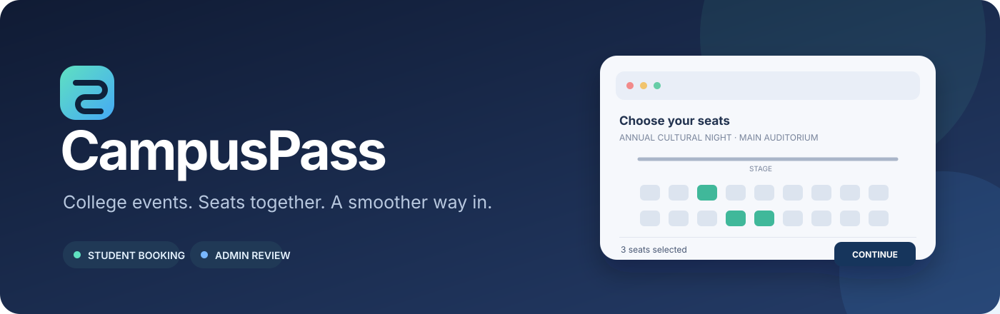
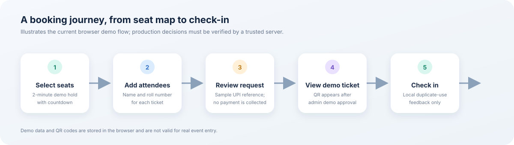

# CampusPass

<p align="center">
  
</p>

<p align="center">
  A college event discovery and seat-booking prototype with separate student and admin experiences.
</p>

<p align="center">
  <a href="https://github.com/rahulxsingh08/event-pass-"></a>
  
  
  
</p>

> [!IMPORTANT]
> **Demo only — not production-secure.** Sign-in, roles, seats, payment review, QR tickets, and check-in are stored or checked in the browser. A user can alter this data with developer tools. The sample admin login is `admin` / `admin`. Do not use real student details, real payments, or these demo tickets for an actual event.

## What it does

CampusPass demonstrates a college event booking flow: students browse events, select seats, enter attendee details, and view demo tickets. Event staff use a separate admin view to manage events and review sample payment references.



### Features

- Event discovery, event details, search, and interactive seat selection
- Two-minute browser-based seat holds with a countdown
- Student sign-up/sign-in using Gmail and a college roll number
- Roll number format check: `2453` followed by exactly eight digits
- Individual name and roll number for each attendee in a group booking
- Sample UPI reference submission with manual demo approval
- A demo QR code for each approved ticket and local duplicate check-in feedback
- Separate student and admin screens
- Supabase schema foundation for profiles, events, seats, holds, bookings, and ticket redemption
- Portable single-file preview for trying the UI without running the dev server

## Try it locally

**Requirements:** Node.js 20+ and npm.

```bash
npm install
npm run dev
```

Open the local URL printed by Vite. On Windows, you can also run `start-campuspass.bat`.

To rebuild the standalone preview:

```bash
npm run build:portable
```

Then open `portable.html`. Do not open `index.html` directly with `file://`; it is the Vite app entry point and needs the dev server.

## Demo access

- **Student:** register with a name, Gmail address, and roll number. Later, sign in with the same Gmail address and roll number.
- **Admin:** username `admin`, password `admin`.
- Demo records are saved in the current browser's local storage. Clearing browser data removes them, and other devices do not share the data.

The roll-number rule checks only the format; it does **not** verify that a student is enrolled. The demo admin password and role checks are client-side and must never be used as real access control.

## How booking works in this demo

1. A student opens an event and selects available seats.
2. The browser holds the seats for up to two minutes and shows a countdown.
3. The student enters the name and roll number for each attendee.
4. Free events create a demo booking. Paid events accept a sample UPI reference for review; this prototype does not collect or verify payment.
5. The admin demo view can approve a request and show a demo QR ticket for each attendee.
6. Check-in marks a code used in this browser only.

For real events, every step that changes a seat, payment, booking, role, or ticket must be enforced by a trusted server and database transaction.

## Architecture at a glance

| Area | Current prototype | Production direction |
| --- | --- | --- |
| UI | React 18, Vite, custom CSS, Lucide icons | Keep the UI and call authenticated server APIs |
| Student identity | Browser form and local email/roll-number map | Google OAuth plus college-roster verification |
| Admin access | Hard-coded demo login and client-side role | Server-verified admin role and database policies |
| Seat holds | Local storage and browser coordination | Atomic database hold with expiry and unique seat constraints |
| Bookings | Browser local storage | Transactional server-side booking and ownership checks |
| Payment | Sample UPI reference and demo approval | Verify payment against a trusted provider or college account |
| QR tickets | Browser-generated demo values | Server-issued, random ticket token with one-time redemption |
| Check-in | Local duplicate-use feedback | Admin-only server endpoint that atomically rejects reused tickets |

## Project files

```text
src/App.jsx             React screens and demo booking flow
src/style.css           Responsive styles
src/main.jsx            React entry point
supabase/schema.sql     Example database schema and protected operations
docs/images/            README illustrations (SVG)
PRESENTATION_GUIDE.md   Walkthrough, architecture explanation, and judge Q&A
SECURITY_MODEL.md       Demo limits, threats, and production controls
```

## Security before real-world use

The SQL schema is a foundation; the current front end does **not** use all of its protected database operations. Before using CampusPass for a real event:

1. Configure Supabase Auth with Google OAuth and serve the app over HTTPS.
2. Verify each roll number against an authoritative college roster.
3. Create seat holds and bookings in trusted server-side transactions.
4. Assign admin roles only through trusted server or database administration.
5. Verify money reached the official account before confirming payment.
6. Issue ticket tokens on the server, store only token hashes, and redeem each token atomically once.
7. Add rate limits, audit logs, cancellation/refund rules, privacy notice, backups, and a support process.

Never put a Supabase service-role key, signing secret, payment secret, or other private credential in a `VITE_*` variable or browser bundle. `.env.example` contains placeholders only.

More details: [Security model](SECURITY_MODEL.md).

## GitHub Pages

A workflow is included at `.github/workflows/pages.yml`. After pushing to `main`, open **Settings → Pages** and choose **GitHub Actions** as the build and deployment source if it is not already selected. Pages hosts the front-end demo only; it does not add authentication or protect browser-stored data.

## Presentation help

See [PRESENTATION_GUIDE.md](PRESENTATION_GUIDE.md) for a short demo script, how the parts fit together, and sample answers to judge questions.

## About the reference

CampusPass is an original implementation. REA (Reverse Engineer Anything) informed an evidence-first approach to understanding application behavior; no REA source code or third-party ticketing-site code is included. The app can be inspected directly in `src/App.jsx` and `supabase/schema.sql`.
